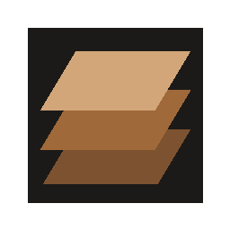
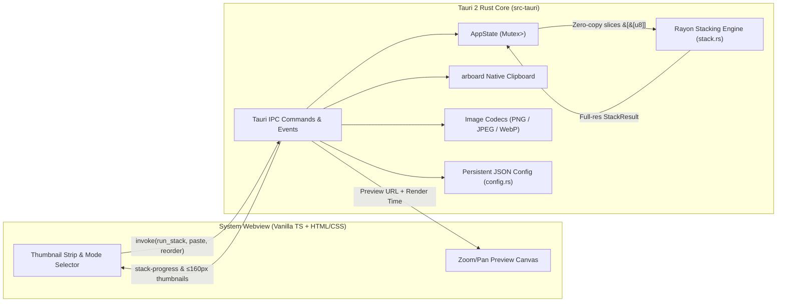
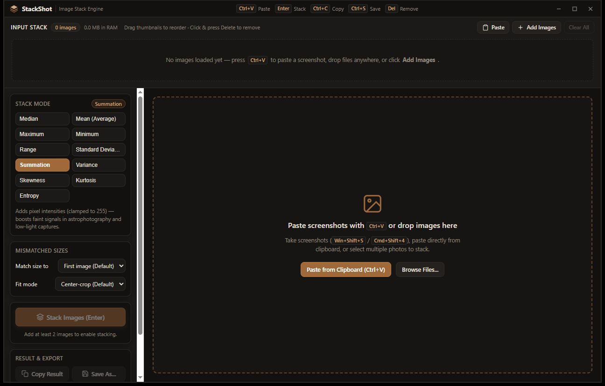

<p align="center">
  
</p>

# StackShot

**StackShot** is a lightweight, high-performance, dark-themed desktop application built with **Tauri 2** and **Rust** that replicates and extends Adobe Photoshop's *Image Stack* modes without needing Photoshop. Quickly paste screenshots (`Ctrl+V` / `Cmd+V`), drag-and-drop photos, pick a statistical stack mode, and copy or save the rendered full-resolution result in milliseconds.

---

## How the Program Works

1. **Instant Image Ingestion**:
   - **Clipboard Paste (`Ctrl/Cmd+V`)**: Reads raw RGBA bitmap data directly from the native OS clipboard via `arboard`. Screenshots taken with `Win+Shift+S` or `Cmd+Shift+4` paste immediately without saving temporary files.
   - **Drag-and-Drop / File Browser**: Multi-select files (`PNG`, `JPEG`, `WebP`, `BMP`, `TIFF`, `GIF`, `ICO`) are decoded in parallel across CPU cores on background worker threads using the Rust `image` and `rayon` crates.
2. **Zero-Copy Frontend Memory Model**:
   - Every source image is decoded **once** in Rust and held in memory as a contiguous raw `RGBA8` byte buffer (`Vec<u8>`).
   - The frontend webview never receives full-resolution source buffers; it receives only a small (`≤160px`) PNG thumbnail data URL and lightweight metadata (`id`, `name`, `width`, `height`, `byte_size`).
   - A real-time **Memory Guard** monitors total and estimated peak RAM usage (capable of handling 30+ 4K images) and offers a one-click **50% Downscale** if memory pressure is high.
3. **Mismatched Size & Aspect Ratio Alignment**:
   - Before stacking, if input images differ in resolution, StackShot aligns them to either the **First image** (default) or **Largest image** using **Center-crop** (default) or **Letterbox** fitting. When dimensions already match, source buffers are borrowed (`Cow::Borrowed`) with zero allocation.
4. **Parallel Statistical Stacking**:
   - When the user clicks **Stack** (or presses `Enter`), Rust spawns a non-blocking background task that partitions the preallocated output buffer into horizontal row-bands using `rayon::par_chunks_mut`.
   - Each CPU core computes pixel statistics independently across all `N` input frames while checking an atomic cancellation flag (`Esc`) and emitting live progress percentages (`stack-progress`) to the UI.
5. **Interactive Viewport & Lossless Export**:
   - Once complete, the full-resolution `RGBA8` output stays in Rust memory while a display preview (`≤2048px`) is rendered in an interactive zoom/pan canvas with a transparency checkerboard backdrop, showing exact output dimensions and render time in milliseconds.
   - Users can **Copy (`Ctrl/Cmd+C`)** the full-resolution result to the system clipboard, **Save As (`Ctrl/Cmd+S`)** in **PNG**, **JPEG** (with 1–100% quality slider), or **WebP**, or **Add the result back to the stack** for multi-pass compositing.

---

## Architecture



### Module Breakdown

| File | Responsibility |
| :--- | :--- |
| `src-tauri/src/stack.rs` | Core parallel stacking engine. Implements all 11 statistical modes, `select_nth_unstable` $O(N)$ median selection, single-pass Welford/Pébay online accumulators, size matching, center-crop/letterbox fitting, parallel LUT auto-normalization, and unit tests. |
| `src-tauri/src/lib.rs` | Tauri application state (`AppState`), native clipboard read/write (`arboard`), parallel file decoding, progress event emission, cancellation (`AtomicBool`), memory footprint estimation, and PNG/JPEG/WebP encoders. |
| `src-tauri/src/config.rs` | Persistent JSON configuration (`settings.json` in the OS app config directory) remembering window dimensions, last-used stack mode, normalization toggle, size/fit settings, JPEG quality, and last save path. |
| `src-tauri/src/main.rs` | Native desktop entry point configured with `windows_subsystem = "windows"` in release builds. |
| `src/main.ts` | Vanilla TypeScript controller handling IPC invocations, drag-and-drop reordering, file drops, keyboard shortcuts, toast notifications, and the zoom/pan viewport. |
| `src/styles.css` | Dark brown theme (`#121110` background, `#1c1a18` panels, `#2e2a26` borders, `#a0693a` primary accent, `#d2a679` tan highlight). |

---

## Stack Modes

All modes operate per-pixel and per-channel (`R`, `G`, `B` computed independently; `Alpha` is set to opaque `255` unless all input images contain transparency). Low-output statistical modes include an **Auto-normalize (0–255)** toggle (enabled by default) that stretches the output range to full contrast.

| Mode | Algorithm | Auto-Normalize | What It Does & When to Use It |
| :--- | :--- | :---: | :--- |
| **Median** | `select_nth_unstable` ($O(N)$ quickselect) | — | Picks the middle value per pixel — removes moving objects, tourists, traffic, or transient noise. |
| **Mean (Average)** | Single-pass integer accumulator | — | Averages pixel values across frames — simulates long exposures, smooths water/clouds, and reduces sensor noise. |
| **Maximum** | Single-pass running max | — | Keeps the brightest pixel value — ideal for star trails, fireworks, light painting, and lightning composites. |
| **Minimum** | Single-pass running min | — | Keeps the darkest pixel value — removes bright flashes, specular glare, or light-colored moving objects. |
| **Range** | Single-pass `max - min` | Yes (Default) | Computes Maximum minus Minimum — highlights total motion amplitude and checks for tripod shift. |
| **Standard Deviation** | Single-pass Welford ($\sqrt{M_2 / N}$) | Yes (Default) | Measures variation from the mean — used in scientific imaging to isolate movement and temporal change. |
| **Summation** | Single-pass clamped sum (`min(255, Σx)`) | — | Adds pixel intensities — boosts faint signals in astrophotography and low-light captures. |
| **Variance** | Single-pass Welford ($M_2 / N$) | Yes (Default) | Squared deviation from the mean — accentuates high-turbulence regions and strong temporal fluctuations. |
| **Skewness** | Single-pass 3rd central moment ($M_3$) | Yes (Default) | Measures asymmetry of pixel distribution over time — detects brief bright or dark directional anomalies. |
| **Kurtosis** | Single-pass 4th central moment ($M_4$) | Yes (Default) | Measures outlier extremity (tailedness) across frames — isolates rare, sudden spikes against steady backgrounds. |
| **Entropy** | 32-bin Shannon entropy ($-\sum p_i \log_2 p_i$) | Yes (Default) | Computes information entropy across frames — maps temporal randomness and visual complexity. |

---

## Keyboard Shortcuts

| Shortcut | Action |
| :--- | :--- |
| `Ctrl+V` / `Cmd+V` | Paste image directly from system clipboard |
| `Enter` | Compute stack with current mode and settings |
| `Ctrl+C` / `Cmd+C` | Copy full-resolution rendered result to clipboard |
| `Ctrl+S` / `Cmd+S` | Save full-resolution result as PNG, JPEG, or WebP |
| `Delete` / `Backspace` | Remove currently selected thumbnail from the strip |
| `Esc` | Cancel an in-progress stack render |
| `Double-Click` (Preview) | Fit preview image to viewport |
| `Scroll Wheel` (Preview) | Smooth zoom in / out around cursor |

---

## How to Run & Build

### 1. Run Pre-Compiled Portable Executable (Windows)
If you have compiled `stackshot.exe` (located at `StackShot.exe` in the project root or `src-tauri/target/x86_64-pc-windows-gnu/release/stackshot.exe`), keep `WebView2Loader.dll` (`157 KB`) in the same folder and double-click **`StackShot.exe`**. It uses the built-in Windows 10/11 WebView2 runtime and requires zero installation.

### 2. Development & Standard Build
```bash
# Install frontend dependencies
npm install

# Start Tauri development window with hot reload
npm run tauri dev

# Run Rust unit tests for the stacking engine
cd src-tauri
cargo test

# Build optimized release binary & installer
npm run tauri build
```

### 3. Building on Windows Without Visual Studio Build Tools (Low Disk Space / Secondary Drive Workaround)
If your `C:` drive is full or you cannot install the multi-gigabyte Visual Studio C++ Build Tools, StackShot can be compiled entirely on a secondary drive (such as `L:`) using a portable **LLVM-MinGW (`ucrt-x86_64`)** toolchain and Rust's `stable-x86_64-pc-windows-gnu` target:

```powershell
# Point all temporary, Rustup, Cargo, and MinGW paths to your secondary drive
$tcRoot = "L:\StackShotToolchain"
$env:TEMP = "$tcRoot\tmp"
$env:TMP = "$tcRoot\tmp"
$env:RUSTUP_HOME = "$tcRoot\rustup"
$env:CARGO_HOME = "$tcRoot\cargo"
$env:PATH = "$tcRoot\llvm-mingw\bin;$env:CARGO_HOME\bin;$env:PATH"

# Build frontend and compile stripped, LTO-optimized release .exe
npm.cmd run build
cd src-tauri
cargo build --release --target x86_64-pc-windows-gnu
```

### Release Optimization Profile (`src-tauri/Cargo.toml`)
```toml
[profile.release]
lto = true
opt-level = 3
codegen-units = 1
strip = true
panic = "abort"
```

---

## Screenshot


